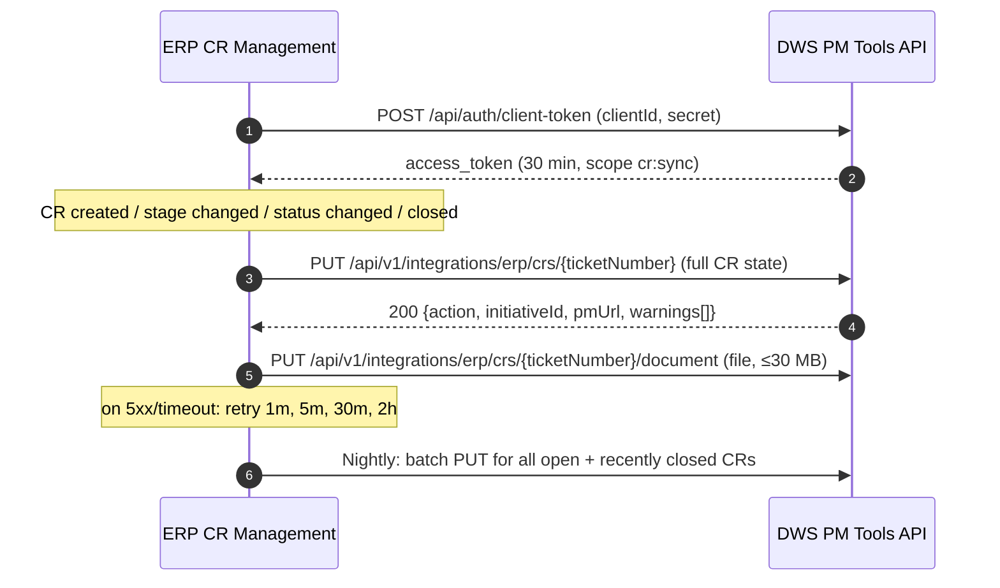

# ERP ⇄ Downstream CR Integration — Design (Draft v0.4)

| | |
|---|---|
| Status | Draft. The mapping follows the **CR System Integration Workbook** (updated 11 Nov 2026). Items marked **OPEN** are not settled yet. |
| Date | 11 Nov 2026 |
| Inputs | `docs/CR System Integration Workbook.xlsx` (**source of truth for the mapping**), `docs/Integrasi CR ERP - Downstream (Bahan Diskusi) v2.pptx` (meeting 28 Oct 2026) |
| Systems | **ERP CR Management** (upstream) → **DWS PM Tools** (downstream, pm.energi-up.com) |

> v0.5 (12 Nov) — built. Branches `feature/erp-external-ids` and `feature/erp-cr-sync-api`; the ERP-facing contract is `docs/ERP-CR-SYNC-API.md`.
> Differences from this design:
> - Resolver department is stored as text (`functionalDepartment`, ERP's column), not a PM table.
> - CR Reference is one text field (`crReference`), not a table.
> - System Impacted is mapped through an **ERP module master** (`erpModules`): `dwsApplications.externalIds` holds ERP module ids.
> - Ownership / Impact Area are captured into one table, `erpOptions` (kind + code + name).
> - The integration log is the `erpIntegrationEvents` table, outside the in-memory store.
>
> Not built yet:
> - Read-only ERP fields in the PM edit form.
> - Admin screens for the integration log and warnings.
> - The "ERP link" screen for existing duplicates.
>
> v0.4 (11 Nov): ERP owns status; Ownership / Impact Area captured from ERP; Dept Head upsert as inactive user; PATCH endpoint added; module-mapping steps.
>
> v0.3 (11 Nov): milestone mapping from the updated workbook; CRs only in Phase 1; Note goes to both Description and Remark; CR Name cut to 120 characters.
>
> v0.2 changes: aligned with the workbook decisions. Ticket Number is the key, stored as **External ID**. External ID columns go on the System Impacted and Department masters. New PM masters: **Resolver Department**, **Ownership / Impact Area**, **CR Reference**. Requester also maps to Business Users. Dept Head maps to IT Manager. Create_at / Closed_Ticket map to Actual Start / End. Documents are copied as files.

---

## 1. Goal and scope

**Problem:** the same SAP change is entered twice (ERP and PM), statuses drift apart, and a change cannot be traced from ERP request to go-live.

**Goal:** a CR created in ERP appears in PM automatically and stays in step with ERP. As agreed, **progress is updated by the Functional in ERP**; PM users (the requesters) only monitor.

**Phase 1:** ERP → PM: create, progress, status, dates, cancellation and the CR document, for every ERP CR.
**Phase 2:** DWS → ERP, only where a case is agreed. The workbook defines the requester format: DWS sends `users.name` and `users.email`.

---

## 2. Approach

**Direct API: ERP pushes to PM and sends the full CR state each time, plus a nightly reconciliation run.** No middleware.
- PM already runs a production integration API (`/api/v1`, client credentials, scopes, timeouts). CR volume is low.
- ERP sends the **whole current state** on every change, so a lost or repeated message does no harm.
- PM upserts on the ERP **Ticket Number** (External ID) and ignores a message that is older than the last one applied (`occurredAt`).



---

## 3. Field mapping (from workbook "General")

| # | ERP field | PM field | How | Workbook decision |
|---|---|---|---|---|
| 1 | Type (CR / Configuration) | **Type** = `CR` (both ERP types); ERP value kept in `externalData.erpType` | Phase 1 handles CRs only (decided 11 Nov) | "ok" |
| 2 | Change Request (rich text, ≤5,000 chars) | **CR Name** (`name`) | HTML converted to plain text and **cut to 120 characters** (ending "…"). The full text goes into Description, after the Note. | ok; 120-char limit decided 11 Nov |
| 3 | Note | **Description** | The Note, then the full Change Request text as plain text (CR Name holds only the first 120 characters) | ok |
| 4 | Ticket Number | **External ID** (new: `initiatives.externalIds`) | Integration key; shown and searchable. PM keeps its own `ticket` (`CRDDMMYYYYNNN`). | DWS adds the "External ID" field |
| 5 | Module, T-Code | **System Impacted** (`systemImpactedIds`) | Through **`dwsApplications.externalIds`** (new) | DWS adds External ID on Master DWS Application |
| 6a | Department (resolver department) | **Resolver Department** (new) | New PM master table + `initiatives.resolverDepartmentId` | DWS creates a new table |
| 6b | — (ERP is adding a requester department) | **Department** (`departmentId`, the requester department) | Through **`departments.externalId`** (new). Example: `AP1` → AP. | ERP creates a new table |
| 7a | Ownership, Impact Area | **Ownership / Impact Area** (new) | New PM tables `ownerships` and `impactAreas`, plus `initiatives.ownershipId` and `initiatives.impactAreaId`. PM has no list of its own: the values are **captured from ERP**. Each code + name ERP sends is added (or renamed) automatically (§4.5). | DWS creates a new table; values come from ERP (11 Nov) |
| 7b | — (ERP is adding Business Impact) | **Business Impact** | PM-owned free text. Not sent by ERP in Phase 1. | ERP creates a new table |
| 8 | Priority (set in Preparation) | **Priority** | High→`P0`, Medium→`P1`, Low→`P2`. Default `P2` until ERP sends it. | confirmed |
| 9 | Requester email | **Business Owner / Requestor** (`businessOwnerId`) | Matched against `users.email` | ERP sends the email only |
| 10 | Functional email | **IT PIC** (`itPicId`, `itPicIds`) | Matched by email against the IT PIC list | same as row 9 |
| 11 | Requester email | **Business Users** (`businessUserIds`) | The requester is added to Business Users | same as row 9 |
| — | — | **IT PM** (`itPmId`) | Always left alone (managed in DWS) | let it null |
| — | Dept Head email (+ name) | **IT Manager** (`itManagerIds`) | Matched by email. **If there is no PM user, one is created** as an inactive placeholder (§4.4). | ERP sends the Dept Head email; upsert decided 11 Nov |
| 12 | Date Creation | **Plan Start Date** | | ok |
| 13 | Target Resolved | **Plan End Date** | | ok |
| 14 | Create_at | **Actual Start Date** (`startDate`) | | ok |
| — | Closed_Ticket | **Actual End Date** (`endDate`) | Also required by PM when Live + Fully Live | ok |
| 15 | Status | **Status** | §4.1 | "Status" tab |
| 16 | Segment / Stage | **Milestone** | §4.2 | "Milestone" tab (SIT → SIT confirmed 11 Nov) |
| 17 | Note | **Remark** | The same Note text goes to both Description and Remark | ok (confirmed 11 Nov) |
| 18 | Document CR (1 file, ≤30 MB) | **Documents** | The file is copied into PM Documents (§5.4) | ok |
| 19 | Project Type | — (kept in `externalData.projectType`) | **Phase 1: CRs only.** Every ERP record arrives as PM type `CR`. Project Type = Yes is kept as a flag and shown on the detail page. Creating PM Projects from ERP is Phase 2. | Rian to check the Project format; CR first (11 Nov) |
| — | CR Reference | **CR Reference** (new table) | `crReferences(initiativeId, externalId)`, links to other ERP tickets | DWS creates a new table |

PM fields not listed above (tasks, comments, meeting notes, documents uploaded in PM) are PM-owned and never touched by the integration.

### Owned fields are read-only in PM
For a CR linked to ERP (`externalSource = 'ERP'`), every PM field fed by ERP in the table above is **read-only** in the PM edit form and shows an "ERP" badge. **Status is included.** Only IT PM, Business Impact, the PM-only milestones (Changes, Fully Live) and PM-only records stay editable. This follows the agreement that the Functional updates progress in ERP.

---

## 4. Value mappings

### 4.1 Status (workbook "Status" tab)
| ERP | PM |
|---|---|
| In Progress | On Track |
| Delayed (spelled "Delated" in the workbook) | Delayed |
| Completed | Live |
| Cancelled | Cancelled |
| (none) | Not Started, On Hold, At Risk — PM only, never sent by ERP |

PM statuses are a fixed list (`Not Started, On Hold, On Track, At Risk, Delayed, Live, Cancelled`).

**Rule (decided 11 Nov):** ERP owns the status. The table is applied as written on every sync: ERP `In Progress` always sets `On Track`, even if PM showed On Hold or At Risk. For ERP-linked CRs the Status field is read-only in PM, so On Hold, At Risk and Not Started are never used for them.

### 4.2 Milestone (workbook "Milestone" tab, updated 11 Nov)
PM looks up the milestone from the pair **(ERP segment, ERP stage)**. The same stage name can mean different things in different segments: for example, `Update FSD Change Request` maps to Signed Changes under Development and SIT, but to UAT under UAT.

| ERP segment | ERP stage | PM milestone |
|---|---|---|
| Preparation | User Initiation | User Initiate |
| Preparation | CR Creation | CR Created |
| Preparation | CR Signed – Section 2 | CR Signed sec 2 |
| Preparation | CR Signed – Section 3 | CR Signed Sec 3 |
| FSD Creation & Approval | FSD Creation | FSD |
| FSD Creation & Approval | Developer Review | FSD |
| FSD Creation & Approval | FSD Approval | FSD |
| Development and SIT | Development | Development |
| Development and SIT | SIT | SIT *(confirmed 11 Nov; the workbook row said Development)* |
| Development and SIT | Extended Development | Development - Extended |
| Development and SIT | Extended SIT | SIT |
| Development and SIT | Update FSD Change Request | Signed Changes |
| Development and SIT | Extended Developer Review | SIT |
| UAT | *any stage* (UAT, Transport, Extended Development / SIT / UAT / Developer Review, Update FSD Change Request) | UAT |
| GO-Live | GO-LIVE | Live (Warranty Period) |
| — (no ERP stage) | — | Fully Live: set in PM by IT after the warranty period |
| — (no ERP stage) | — | Changes: PM only, set by hand |

Rules:
- Segment and stage names are compared ignoring case and extra spaces, because the workbook values contain tabs and spellings such as `user initation`.
- If ERP sends a (segment, stage) pair that isn't in the table, the milestone is left unchanged and an `UNMAPPED_STAGE` warning is raised. The other fields still update.
- **Fully Live and Changes are PM-owned.**
  - ERP never sets them. Once IT has set Fully Live, ERP's GO-LIVE doesn't move the CR back to Live (Warranty Period).
  - PM users may set Changes by hand. The next ERP stage change overwrites it.
- The legacy PM value `Live` is never produced.
- When a milestone is passed, the matching auto-created PM CR task is set to `done`. When the CR is cancelled, its tasks are set to `cancel`.

### 4.3 Priority (workbook "Priority" tab)
High → P0, Medium → P1, Low → P2. The PM priority list is fixed.

### 4.4 Users
- Requester, Functional and Dept Head are matched by **email** against PM `users.email`.
  - Matching ignores case. For example, PM stores `Christiyan.martheen@kpn-corp.com`.
  - Requester and Functional are matched to active users only. Dept Head is matched to any user, active or not, so a placeholder is never created twice.
- Functional (IT PIC) must be one of the users on the workbook's IT PIC list: active, with role IT / IT - PM / Admin, or an admin.
- PM users have emails on **two domains** (`@kpn-corp.com` and `@energi-up.com`). ERP must send the same address that PM holds.
- **Requester / Functional with no match:** the field is left empty, the CR is still created, and a `USER_UNMAPPED` warning goes to the admin "Needs mapping" list.
- **Dept Head with no match (upsert, decided 11 Nov):** PM creates a placeholder user and sets it as the CR's IT Manager.
  - Created with: `name` = `deptHeadName` from ERP (if missing, built from the email: `head.name@…` → "Head Name"), `email`, `active = false`, no password, not admin, `role` empty.
  - A `USER_CREATED` warning is returned and the user is listed for the admin.
  - **Why inactive:** PM's DWS Hub SSO logs in any *existing* user whose email matches, unless the user is marked inactive. An active placeholder would therefore give that person PM access the moment they use the Hub. Created inactive, the name appears on the CR, and the person can log in only after an admin activates them on the Users page.
  - Already a PM user, even an inactive one → that user is reused. Nothing is created twice.
  - The same upsert can be switched on for Requesters later if wanted.

### 4.5 Master data with External ID
| PM master | New column | Filled by | State in workbook |
|---|---|---|---|
| Department (`departments`) — requester department | `externalId` | DWS admin, using the ERP requester-department codes | 1 of 23 filled (`AP1` → AP) |
| System Impacted (`dwsApplications`) | `externalId` | DWS admin, using the ERP Module / T-Code | 0 of 15 filled |
| Resolver Department (new) | `externalId` (+ name) | Loaded from the ERP resolver-department list | Table to be created |
| Ownership (new `ownerships`) and Impact Area (new `impactAreas`) | `externalId` + `name` | **Captured automatically from ERP.** An unknown code is added; a known code with a new name is renamed. No admin set-up needed. | Decided 11 Nov |

Notes from the workbook data:
- **Module → System Impacted is many-to-one.** Every SAP module points to either **SAP FICO** or **SAP NON FICO**. The `externalId` must therefore hold **several codes** (stored as a comma-separated list, as PM does for other multi-value fields), or ERP must send the target system directly. (OPEN-3)

  | PM System Impacted | `externalId` (proposed) | A CR from ERP with Module… |
  |---|---|---|
  | SAP FICO | `FI,CO` | `FI` or `CO` → SAP FICO |
  | SAP NON FICO | `MM,SD,PP,PM,QM,WM` (to be confirmed by ERP) | `MM` → SAP NON FICO |
  | Any other system (EXIM, Jetty, …) | empty | not reachable from ERP |

  The T-Code (e.g. `ZMM001`) is not used for this lookup. It is kept for display only.

  **How to map it (steps):**
  1. Ask the ERP team for the full list of **Module codes** their CR form offers (the "Module" master, filtered by Department).
  2. For each code, decide whether it belongs to **SAP FICO** or **SAP NON FICO**. Write it in the workbook "System Impacted" sheet, column A (External ID), as a comma list on the SAP FICO and SAP NON FICO rows.
  3. Once the External ID field is built, enter the same lists on **Master DWS Application** (or PM loads them from the workbook in one go).
  4. Rules PM enforces: a code may appear on **only one** system (saving a duplicate is refused); codes are compared ignoring case; an unknown module → System Impacted left empty plus an `UNMAPPED_MODULE` warning.
- **Departments need clean-up before mapping.** There are duplicates (`TAX` / `Tax`) and legacy names (`Operation`, `Trader`, which PM already shows as Industrial and Commercial).

---

## 5. API contract (PM as provider)

### 5.1 Authentication
- Use the existing `POST /api/auth/client-token`.
- One API client per environment.
- New scope **`cr:sync`**, accepted only on the integration endpoints.

### 5.2 `PUT /api/v1/integrations/erp/crs/{ticketNumber}` — create or update

```json
{
  "eventId": "6c1b0f0e-6a0e-4c2e-9d0a-5b6c1a2f9e11",
  "eventType": "cr.stage_changed",
  "occurredAt": "2026-11-12T03:15:00Z",
  "cr": {
    "ticketNumber": "#ERPO138381",
    "crId": "CR000000123",
    "url": "https://erp.example/cr/CR000000123",
    "type": "Change Request",
    "projectType": false,
    "changeRequest": "<p>Add vendor tax field to ZMM001 …</p>",
    "note": "Free text",
    "moduleCode": "MM",
    "tCodes": ["ZMM001"],
    "resolverDepartmentCode": "SAP-MM",
    "requesterDepartmentCode": "AP1",
    "ownership": { "code": "OWN-01", "name": "Procurement" },
    "impactArea": { "code": "IA-03", "name": "Purchasing" },
    "priority": "High",
    "requesterEmail": "budi@kpn-corp.com",
    "functionalEmail": "adinda.nisa@kpn-corp.com",
    "deptHeadEmail": "head@kpn-corp.com",
    "deptHeadName": "Head Name",
    "dateCreation": "2026-11-02",
    "targetResolved": "2026-12-15",
    "createdAt": "2026-11-02T02:10:00Z",
    "closedAt": null,
    "status": "In Progress",
    "segment": "FSD Creation & Approval",
    "stage": "Developer Review",
    "crReferences": ["#ERPO130001"]
  }
}
```

- Required on every call: `ticketNumber`, `changeRequest`, `status`, `segment`, `stage`, `functionalEmail`, `requesterEmail`, `dateCreation`, `targetResolved`, `createdAt`, `occurredAt`.
- Values that don't match a PM master or user are accepted: the field is left empty and a warning is returned.

**Response `200`**
```json
{ "action": "created|updated|unchanged|ignored_stale", "initiativeId": "…", "pmTicket": "CR12112026001",
  "pmUrl": "https://pm.energi-up.com/#view/…", "warnings": [{ "code": "USER_UNMAPPED", "field": "deptHeadEmail" }] }
```

**Errors**
| Code | Meaning | What ERP should do |
|---|---|---|
| `400` | Invalid payload | Fix the data; don't resend unchanged |
| `401` | Token expired | Get a new token and retry |
| `403` | Scope missing | Alert |
| `5xx` / timeout | PM unavailable | Retry with backoff |

### 5.3 Other endpoints
- `GET /api/v1/integrations/erp/crs/{ticketNumber}`: PM's view of the CR (PM id, URL, last applied state, warnings).
- `PUT /api/v1/integrations/erp/crs` (batch, up to 200): for the nightly reconciliation and the first back-fill. A PM save rewrites the whole store, so one batch costs one write.
- `PATCH /api/v1/integrations/erp/crs/{ticketNumber}` (**partial update, built now and kept for later use**, decided 11 Nov).
  - Same field names as §5.2, but every field is optional; only the fields sent are changed.
  - It uses the same mapping and the same rules: ERP-owned fields only, and stale `occurredAt` is ignored.
  - The CR must already exist, otherwise `404`. Creating always goes through PUT.
  - The main flow stays the full-state PUT, because a lost PATCH is not corrected until the next full PUT or the nightly run.

### 5.4 Document
- `PUT /api/v1/integrations/erp/crs/{ticketNumber}/document` (multipart, one file, ≤30 MB).
- It replaces the earlier ERP document for that CR (ERP holds one file per CR) and is stored with `uploadedBy = "ERP Integration"`.
- PM's current upload limit is 10 MB (`routes/documents.js`). The integration endpoint gets its own 30 MB limit.
- Documents uploaded in PM by users are not affected.

---

## 6. Processing in PM

1. Check the scope and validate the payload.
2. Find the CR by `externalSource='ERP'` and `externalIds` contains `ticketNumber`. Ignore stale messages.
3. Map the fields using §3 and §4, and collect warnings.
4. **Create:** do the same as `POST /api/initiatives`: PM ticket, `changeRequests` row, and the CR tasks.
   **Update:** write only ERP-owned fields.
5. Write one `changeHistory` entry with `changedBy = "ERP Integration"`.
6. Save `externalSyncedAt`, `externalWarnings` and `externalData` (`crId`, `url`, `erpType`, `segment`, `stage`, `tCodes`, raw HTML).
7. Log the call in `integrationEvents`. A repeated `eventId` returns the earlier result.

**Side effects**
- The SAP FICO / SAP NON FICO **CR-creation email** must not fire for ERP-created CRs, because ERP has already handled the request.
- PM currently sends no status or milestone notifications, so the integration adds none.

**Reconciliation**
- **Nightly:** ERP sends a batch of all open CRs plus those closed in the last 30 days.
- **Weekly admin report:** linked CRs whose sync has gone stale, and SAP CRs in PM with no External ID.

**Existing duplicates:** an admin "ERP link" screen to attach an existing PM CR to an ERP Ticket Number. After that, the next sync replaces the ERP-owned fields.

---

## 7. PM build list

| # | Area | Change | Size |
|---|---|---|---|
| 0 | Security (prerequisite) | Block API-client tokens on the internal `/api/initiatives` routes, and add role/assignment checks to `POST`/`PUT /api/initiatives` | S |
| 1 | Schema (`store.js`) | `initiatives`: `externalSource`, `externalId`, `externalSyncedAt`, `externalData`, `externalWarnings`, `resolverDepartmentId`, `ownershipId`, `impactAreaId`. `departments.externalId`, `dwsApplications.externalIds`. New tables: `resolverDepartments`, `ownerships`, `impactAreas`, `crReferences`, `integrationEvents`. Each needs DDL, read mapping and INSERT. | M |
| 2 | Masters UI | External ID on Department and Master DWS Application. New admin pages for Resolver Department and for Ownership / Impact Area (read-only lists, filled from ERP). Inactive placeholder users created by ERP are shown on the Users page. | M |
| 3 | CR form / detail / list | New fields (Resolver Department, Ownership, Impact Area, CR References, External ID). ERP badge and read-only owned fields. External ID column, search and a Source filter. | M |
| 4 | API | `routes/integrations-erp.js` (PUT single, PUT batch, PATCH partial, GET, document) and scope `cr:sync`. OpenAPI v1.3. | M |
| 5 | Mapper | `services/erp-cr-mapper.js` with unit tests built from the workbook tabs | M |
| 6 | Admin | Integration Log, Needs-mapping queue, ERP link screen | L |
| 7 | Email | Suppress the creation email for ERP CRs | S |

**ERP side (from the workbook):**
- Add a requester-department table and a Business Impact table.
- Send emails for Requester, Functional and Dept Head.
- Add Create_at / Closed_Ticket.
- Send segment and stage on each change.
- Push the CR document.

---

## 8. Non-functional
- **Volume:** low. Reconciliation and back-fill must use the batch endpoint, because every PM save rewrites the whole store.
- **Timeouts:** 5 s for a single call, 30 s for a batch or document.
- **Security:** HTTPS in production; a separate secret per environment; `cr:sync` scope only. The integration log contains emails, so it is admin-only and kept for 180 days.

## 9. Rollout
1. Close the OPEN items.
2. Fill the External IDs and load the new masters.
3. Build on `SIT`.
4. PoC on staging with 10–20 CRs.
5. Link existing duplicates.
6. Go live. ERP becomes the only intake for SAP CRs.

---

## 10. Open items

### Decided on 11 Nov 2026
| # | Decision |
|---|---|
| OPEN-1 | **CRs first.** Every ERP record comes in as PM type `CR`, and Project Type is kept as a flag. Creating PM Projects from ERP is Phase 2. |
| OPEN-2 | **Note goes to both Description and Remark.** T-Codes are stored in `externalData` (shown in the ERP panel); CR References go in the CR Reference table. |
| OPEN-4 | **ERP owns the status.** ERP `In Progress` always sets `On Track`, and Status is read-only for ERP CRs (§4.1). |
| OPEN-5 | **Ownership and Impact Area are new to PM.** PM adds two tables and fills them automatically from the code + name ERP sends (§4.5). |
| OPEN-6 | **Milestone mapping comes from the workbook tab** (§4.2), looked up by (segment, stage). |
| OPEN-7 | **CR Name is cut to 120 characters.** The full Change Request text is kept in Description, after the Note. |
| OPEN-8 | **Dept Heads should have PM accounts.** If one doesn't, PM creates an inactive placeholder user, and an admin activates it (§4.4). ERP is asked to also send `deptHeadName`. |
| OPEN-9 | **The main flow is ERP → PM only.** PM still builds a `PATCH` partial-update endpoint now, for later use (§5.3). |
| OPEN-10 | **Development and SIT / SIT → `SIT`**, not Development as the workbook row said. Extended Developer Review → `SIT` stays as written. |

### Still open
| # | Question | Who / next step |
|---|---|---|
| OPEN-3 | **Module codes for SAP FICO and SAP NON FICO.** | ERP team to send their Module list; Rian fills workbook "System Impacted" column A (steps in §4.5) |
| OPEN-11 | **Resolver Department values and codes** (new PM table). | ERP team to send the list. Proposal: capture them automatically from ERP, the same way as Ownership / Impact Area. |
