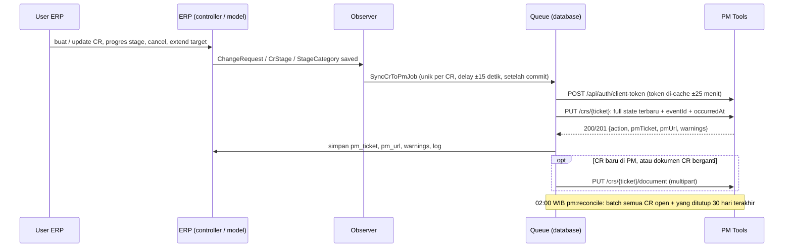

# Rencana Integrasi: ERP CR → PM Tools (ERP CR Sync API v1.0)

> Status: **draft untuk diskusi**, 16 November 2026
> Sumber: dokumen *PM Tools ERP CR Sync API v1.0* (tim PM Tools / DWS IT) dan kode aplikasi ini.
> Menggantikan [`plan.md`](plan.md) (28 Okt 2026), yang ditulis untuk API lama (list + PATCH saja).

## 1. Ringkasan

- PM Tools sekarang menyediakan **API khusus untuk ERP**, dengan pola *push full state*: setiap kali
  sebuah CR berubah di ERP, ERP mengirim `PUT /api/v1/integrations/erp/crs/{ticketNumber}` berisi
  **seluruh kondisi CR terbaru**. PM membuat CR itu pada kiriman pertama dan meng-update-nya pada
  kiriman berikutnya.
- **Kuncinya Ticket Number ERP**, bukan UUID PM. Tidak perlu lagi link manual, pencarian, atau
  pencatatan ganda.
- **PM yang memetakan nilai**: status, milestone (dari segment + stage), priority, dan user (lewat
  email). ERP cukup mengirim nilai apa adanya. Nilai yang tidak bisa dipetakan PM tidak membuat
  kiriman gagal; PM mengembalikan `warnings`.
- **Aman diulang dan tidak harus berurutan**: setiap pesan membawa `eventId` (dedup retry) dan
  `occurredAt` (PM hanya menyimpan kondisi terbaru). ERP tidak butuh antrean yang ketat urutannya.
- ERP juga mengirim **dokumen CR** (satu file, maks 30 MB), **master modul**, dan **batch rekonsiliasi
  harian** pukul 02:00 WIB.

### Apa yang berubah dibanding `plan.md`

| Gap lama | Status di API v1.0 |
|---|---|
| G1 tidak ada endpoint create | **Selesai**: `PUT` membuat CR bila belum ada |
| G2 tidak ada field referensi ERP | **Selesai**: Ticket Number ERP menjadi kunci, plus `crId` dan `url` |
| G3 tidak ada get-by-id | **Selesai**: `GET .../crs/{ticketNumber}` |
| G4 master user/department pakai UUID PM | **Selesai**: user lewat email, department lewat kode, modul lewat master |
| G6 milestone case-sensitive | **Selesai**: PM yang memetakan, nama dibandingkan tanpa beda huruf/spasi |
| G19 dokumen tidak didukung | **Selesai**: `PUT .../document` |
| G12 timeout 5 detik | Sekarang 30 detik; dedup lewat `eventId` |

Yang **masih** terbuka ada di §9 (gap baru) dan §10 (keputusan).

## 2. Endpoint yang dipakai ERP

| # | Endpoint | Kapan ERP memanggil |
|---|---|---|
| 1 | `POST /api/auth/client-token` | Ambil token (berlaku 30 menit, tanpa refresh token) |
| 2 | `PUT /api/v1/integrations/erp/crs/{ticketNumber}` | **Panggilan utama**: setiap perubahan CR |
| 3 | `PUT /api/v1/integrations/erp/crs` | Batch maks 200: rekonsiliasi harian dan first load |
| 4 | `PUT /api/v1/integrations/erp/crs/{ticketNumber}/document` | Setelah CR dibuat di PM, dan setiap dokumen CR berganti |
| 5 | `PUT /api/v1/integrations/erp/modules` | Sekali di awal, lalu setiap master modul berubah |
| 6 | `GET /api/v1/integrations/erp/crs/{ticketNumber}` | Diagnostik / tombol "cek di PM" (opsional) |
| — | `PATCH .../crs/{ticketNumber}` | **Tidak dipakai.** Dokumen sendiri menyarankan `PUT`; PATCH yang hilang hanya terkoreksi oleh PUT berikutnya |

| Lingkungan | Base URL |
|---|---|
| Staging | `http://test-pm.kpndomain.com` (catatan: **HTTP, bukan HTTPS**, lihat N9) |
| Production | `https://pm.energi-up.com` |

Setiap lingkungan punya `clientId` / `clientSecret` sendiri dengan scope `cr:sync`.

## 3. Arsitektur



**Prinsip desain**

1. **Full state, dibangun saat job jalan.** Job tidak membawa payload dari saat event terjadi; ia
   membaca CR dari database saat dieksekusi. Sepuluh perubahan beruntun dalam satu request
   (umum, karena progres stage menyentuh stage, segment, dan CR sekaligus) jadi satu kiriman.
2. **Dipicu observer, bukan controller.** Status CR dan stage ditulis di ±12 file (`DetailStageController`,
   `StagesController`, `SectionApprovalController`, `SegmentStageProgressSynchronizer`, `ExtendController`, dll.).
   Semuanya lewat model Eloquent, tidak ada mass update query-builder pada kolom yang relevan, jadi observer
   menangkap semuanya tanpa menyentuh tiap controller.
3. **Asinkron dan tidak pernah memblokir user.** Kegagalan PM tidak pernah membatalkan aksi di ERP.
   Hasil dan error dicatat, lalu ditampilkan di layar CR.
4. **Bisa dimatikan total**: `PM_SYNC_ENABLED=false` (default). Lihat N8 soal `.env` lokal.

## 4. Mapping field `cr`

Kolom sumber mengacu ke `change_requests` kecuali disebut lain.

| Field API | Wajib | Sumber di ERP | Catatan |
|---|---|---|---|
| `ticketNumber` | Ya | `ticket_number` | Kunci. **Tidak unik di ERP**, lihat N1. URL-encode `#` → `%23` |
| `changeRequest` | Ya | `change_request` (HTML, sudah di-sanitize) | PM memotong 120 karakter untuk nama CR; HTML boleh |
| `note` | — | `cr_note` | |
| `status` | Ya | `status` | Lihat §5.1 |
| `segment` | Ya | nama `stage_categories` posisi saat ini | Lihat §5.2 |
| `stage` | Ya | nama `cr_stages` posisi saat ini | Lihat §5.2 |
| `requesterEmail` | Ya | `email_requester` | Bisa kosong di CR lama, lihat N3 |
| `functionalEmail` | Ya | `functional_id` → `users.email` | `pic_sap` hanya teks; CR tanpa `functional_id` lihat N3 |
| `dateCreation` | Ya | `date_receive` | Menjadi *Plan Start Date* di PM, lihat K4 |
| `targetResolved` | Ya | `target_resolve` | Berubah lewat persetujuan extension Dept Head |
| `createdAt` | Ya | `created_at` | Menjadi *Actual Start Date* di PM, lihat K4 |
| `closedAt` | — | `closed_ticket` | Dikirim `null` selama CR belum ditutup |
| `priority` | Setelah terisi | `priority` (`high`/`medium`/`low` → `High`/`Medium`/`Low`) | Diisi di Section 1. **Jangan kirim** selama kosong; PM memberi default P2 |
| `deptHeadEmail` / `deptHeadName` | — | `User::extensionApproverFor($cr)` | Dept Head dari department Functional = *IT Manager* di PM. Rantai yang sama dengan approval extension target |
| `requesterDepartmentCode` | — | `department_id` → `departments.department_code` | **Ini department modul**, bukan department requester (kolomnya diturunkan dari modul). ERP tidak menyimpan department requester, lihat N15. PM perlu mendaftarkan kode yang sama |
| `moduleId` / `moduleName` | — | `module_id` / `modules.name` | `moduleId` = id modul ERP apa adanya (contoh `MD000000001`, bukan `FI`) |
| `tCode` | — | `t_code` | |
| `functionalDepartment` | — | `functional_department` | Kolom baru (migration 2026_11_12) |
| `ownership` | — | `job_area_id` → `job_areas {id, name}` | `{ code: id, name }` |
| `impactArea` | — | `change_request_impact_areas` → `job_areas` | **ERP bisa punya banyak, API hanya satu**, lihat N4 |
| `crReference` | — | `cr_reference` | Pastikan isinya Ticket Number, bukan CR ID ERP |
| `crId` | — | `id` (mis. `CR000000123`) | |
| `url` | — | `route('crdata.show', id)` | Link balik ke ERP |
| `type` | — | `type`: `cr` → `Change Request`, `config` → `Configuration` | |
| `projectType` | — | `is_project` | |

Aturan PM: `null`/`""` **mengosongkan** field PM, field yang tidak dikirim tidak mengubah apa-apa. Karena itu
payload builder memakai daftar field tetap, dan field opsional yang di ERP memang kosong dikirim sebagai
`null` (kecuali `priority`, lihat di atas).

## 5. Mapping nilai

### 5.1 Status

| `change_requests.status` | Dikirim sebagai | Status di PM |
|---|---|---|
| `in progress` | `In Progress` | On Track |
| `delayed` | `Delayed` | Delayed |
| `completed` | `Completed` | Live |
| `cancelled` | `Cancelled` | Cancelled |
| `rejected` (ditolak di Section 3) | `Cancelled` | Cancelled, lihat K3 |
| kosong / lain | `In Progress` + log warning ERP | |

Nilai lain ditolak PM dengan `400`, jadi normalisasi dilakukan di ERP (`strtolower(trim())`, sama seperti
`ChangeRequest::isClosed()`).

### 5.2 Segment + stage, dan posisi CR saat ini

**Posisi saat ini**: stage `active` terakhir di segment `active` terakhir (`ChangeRequest::lastActiveStage()`).
Kalau tidak ada (CR baru atau sudah selesai), pakai stage `completed` terakhir menurut urutan segment lalu
stage, logika yang sama dengan kolom *Last Stage* di `ChangeRequestController::index()`. CR tanpa stage sama
sekali dikirim sebagai `Preparation` / `CR Creation`, lihat K5.

Nama dikirim **apa adanya** dari data; PM yang memetakan. Tabel PM dibandingkan dengan nama di ERP:

| ERP segment / stage | Tabel PM | Hasil |
|---|---|---|
| Preparation / `CR - Section 1` | **tidak ada** | `UNMAPPED_STAGE`, milestone tidak berubah (N5) |
| Preparation / `CR Signed - Section 2`, `CR Signed - Section 3` | ada | CR Signed sec 2 / Sec 3 |
| **`FSD Creation & Approvals`** / FSD Creation, Developer Review, FSD Approval | PM menulis `FSD Creation & Approval` (**tanpa "s"**) | Berisiko `UNMAPPED_STAGE` untuk seluruh segment FSD (N5) |
| Development and SIT / Development, SIT, Extended Development, Extended SIT, Update FSD Change Request, Extended Developer Review | ada | sesuai tabel PM |
| Development and SIT / `Update FSD Change Request Approval` | **tidak ada** | N5 |
| UAT / apa pun (UAT, Extended UAT, Transport) | ada (`any stage`) | UAT |
| `Go-Live` / `GO-LIVE` | ada (beda huruf diabaikan) | Live (Warranty Period) |
| CR type `config`: stage konfigurasi | **tidak ada** | N5 |

Nama stage di ERP adalah data template yang bisa diubah admin. Sebelum go-live, ambil daftar
pasangan segment/stage yang benar-benar ada di production (query di §8 Fase 0) dan kirim ke tim PM.

### 5.3 Event type

`eventType` hanya untuk log PM, tapi berguna untuk menelusuri. Diturunkan dari perubahan yang memicu job:

| Pemicu | `eventType` |
|---|---|
| CR dibuat | `cr.created` |
| Section 1 scan / Section 2–3 approval selesai | `cr.signed` |
| Stage / segment berubah status | `cr.stage_changed` |
| `status` CR berubah | `cr.status_changed`, atau `cr.closed` / `cr.cancelled` |
| Field lain (target, priority, requester, dll.) | `cr.updated` |
| Batch harian / backfill | `cr.reconcile` |

Bila beberapa pemicu digabung dalam satu job, ambil yang paling "kuat" (closed > cancelled > signed >
stage_changed > status_changed > updated).

### 5.4 Jawaban ERP atas pertanyaan tim PM soal segment/stage (16 Nov 2026)

Jawaban di bawah disusun dari kode ERP. Daftar stage persisnya disimpan di database
(`categories` → `master_stages`) dan diatur admin lewat `/master-stages`. `MasterStageSeeder` kosong,
jadi **Q1 dan Q3 baru final setelah query di akhir bagian ini dijalankan di production**. Penjelasan
umum hierarkinya ada di [`../hierarki-segment-stage.md`](../hierarki-segment-stage.md).

**Q1. Nama stage persis per template (tipe cr dan config, termasuk Go-Live dan stage extended)**

Nama yang dipakai kode (konstanta `CrStage`, `ExtendController`, migrasi):

| Segment | Stage | `type` |
|---|---|---|
| Preparation | User Initiation, CR Creation, CR Verification *(dari contoh `weekly-report-perhitungan.md`, perlu konfirmasi)*, `CR - Section 1`, `CR Signed - Section 2`, `CR Signed - Section 3` | `preparation` |
| FSD Creation & Approvals | `FSD Creation`, `Developer Review`, `FSD Approval` | `fsd` / `fsd_approval` |
| Development and SIT | `Development` (sub stage: ABAP / BW / Digital Application Development), `SIT` | `development` |
| UAT | `UAT`, `Transport` | `uat` |
| Go-Live | `GO-LIVE` | `golive` |

Stage **extended** tidak disalin saat CR dibuat (`ChangeRequestStageInitializer` melewati type
`%extended%` / `%extender%`). Stage ini ditambahkan ke segment yang di-extend oleh `ExtendController`:

| Template extend | Stage yang ditambahkan |
|---|---|
| `extended_development` | Extended Development, Extended SIT |
| `extended_development_with_fsd` | Update FSD Change Request, Extended Developer Review, Extended Development, Extended SIT |
| `extender_uat` | Extended UAT |
| `extender_uat_with_fsd` | Update FSD Change Request, Extended Developer Review, Extended Development, Extended UAT |

Urutan dan isi tabel extend di atas berasal dari kode dan perlu dicocokkan dengan hasil query. Sejak
migrasi `2026_08_21_000100`, `Update FSD Change Request Approval` dihapus dari template extend. CR
yang sudah di-extend sebelum itu masih punya stage tersebut.

**Template config belum pasti.** `CategoryTypeSeeder` memberi template config 5 segment dengan nama
yang sama seperti tipe cr. Tetapi seed permission (`2026_08_12_000100`), template import
(`DetailCrImportTemplateSheet`) dan export (`ChangeRequestReportExport`) semuanya menyebut segment
**`Configuration`**. Hasil query yang menentukan.

**Q2. Apakah segment dan stage punya kode/ID stabil, supaya tidak mencocokkan nama?**

- **Segment: sebagian.** `stage_categories.category_id` menunjuk ke `categories.id`, UUID template yang
  stabil. Tetapi kolomnya nullable (CR lama bisa kosong, dan `onDelete set null`), dan template cr dan
  config punya ID berbeda walaupun namanya sama.
- **Stage: tidak ada.** `cr_stages` tidak punya `master_stage_id`. Salinan hanya menyimpan nama.
  `cr_stages.id` adalah UUID per CR, jadi tidak bisa dipakai untuk mapping. `type` juga bukan kode unik:
  `preparation` dipakai semua stage Preparation, dan `uat` dipakai bersama oleh UAT dan Transport.
- **Opsi:** (a) tambah kolom `cr_stages.master_stage_id`, lalu isi untuk data lama dengan pencocokan nama;
  atau (b) sepakati kode stabil sendiri (misalnya `PREP_SECTION_1`) yang dikirim di samping nama. Selama
  itu belum ada, mapping memakai nama, yang sudah dibandingkan PM tanpa beda huruf/spasi. Lihat K9.

**Q3. Apakah "CR - Section 1" sama dengan "User Initiation" di workbook? Apakah stage "CR Creation" ada?**

- **Tidak sama di data.** `CR - Section 1` ditambahkan pada 2026-09-09 (migrasi `2026_09_09_000200`),
  disisipkan tepat **sebelum** `CR Signed - Section 2`, dan tidak menggantikan stage lain. Isinya halaman
  Section 1 dokumen CR yang diisi Requester dan ditandatangani di atas kertas. Secara makna mirip "User
  Initiation", tetapi keduanya stage terpisah.
- CR yang dibuat **sebelum 2026-09-09 tidak punya** `CR - Section 1` (migrasi sengaja tidak menyentuh CR
  yang sudah berjalan).
- `CR Creation` muncul pada contoh data Agustus di `weekly-report-perhitungan.md`, bersama `User Initiation`
  dan `CR Verification`. Kemungkinan besar ada di template Preparation; query di bawah yang memastikan.
  Ini juga menjawab K5: kalau `CR Creation` memang ada, nama itu aman dipakai untuk CR tanpa stage.

**Q4. Bisakah ERP mengirim struktur `segments[]` lengkap di setiap pesan?**

**Bisa.** Semua nilainya sudah tersimpan per baris dan tidak perlu dihitung ulang. Payload builder memang
membaca CR dari database saat job berjalan (§3). Ukurannya sekitar 5–6 segment × 3–6 stage per CR.

```json
"segments": [
  {
    "sequence": 1, "name": "Preparation", "bobot": 20, "status": "completed", "progress": 100,
    "stages": [
      { "sequence": 1, "name": "CR - Section 1", "type": "preparation", "status": "completed",
        "startDate": "2026-11-03", "endDate": "2026-11-04", "progress": 100 }
    ]
  }
]
```

| Field | Sumber |
|---|---|
| segment `sequence`, `name`, `bobot`, `status`, `progress` | `stage_categories` |
| stage `sequence`, `name`, `type`, `status`, `startDate`, `endDate` | `cr_stages` |
| stage `progress` | `cr_stages.until_this_week_progress` |

Yang perlu disepakati dengan PM:

- Jumlah stage bisa **bertambah** setelah extend. Stage extended ditambahkan di akhir segment yang
  di-extend, dengan `sequence` lanjutan.
- `progress` segment adalah **rata-rata** progress stage-nya. Progress CR adalah **jumlah bobot** segment
  yang sudah selesai, bukan rata-rata. Segment yang 90% belum menyumbang apa pun ke progress CR.
- Apakah sub stage (ABAP / BW / Digital Application Development) ikut dikirim. Usulan: belum, cukup progress
  stage `Development`.
- Bentuk JSON di atas hanya usulan. Nama field mengikuti keputusan tim PM.

**Q5. Configuration dihitung sebagai milestone PM apa? (usulan PM: Development)**

**Setuju: Development.** Untuk CR tipe config, Configuration menempati posisi Development and SIT, dan seed
permission memperlakukan keduanya sama (role developer memegang `Development` dan `Configuration`,
`2026_08_12_000100_seed_default_role_stage_permissions.php`). Ini dengan catatan template config memang
punya segment Configuration (lihat Q1).

**Query untuk dijalankan di production (baca saja, PostgreSQL)**

```sql
-- Q1: template saat ini
SELECT c.type AS template, c.sequence AS seg_seq, c.name AS segment, c.bobot,
       ms.sequence AS stage_seq, ms.name AS stage, ms.type AS stage_type
FROM categories c
LEFT JOIN master_stages ms ON ms.category_id = c.id
ORDER BY c.type, c.sequence, ms.sequence;

-- Q1/Q3: nama yang benar-benar ada di CR (CR lama bisa memakai nama lama)
SELECT sc.name AS segment, cs.name AS stage, cs.type, COUNT(*) AS jumlah
FROM cr_stages cs
JOIN stage_categories sc ON sc.id = cs.stage_category_id
GROUP BY 1, 2, 3
ORDER BY 1, 2;
```

Query kedua penting karena salinan menyimpan **nama**. Mengganti nama di template tidak mengubah CR yang
sudah berjalan. Hasil kedua query ini juga yang dikirim ke tim PM untuk N5.

## 6. Desain teknis di sisi ERP

### 6.1 Konfigurasi: `config/pm_sync.php`

```dotenv
PM_SYNC_ENABLED=false          # kill switch, default mati
PM_SYNC_BASE_URL=              # http://test-pm.kpndomain.com | https://pm.energi-up.com
PM_SYNC_CLIENT_ID=
PM_SYNC_CLIENT_SECRET=
PM_SYNC_TIMEOUT=30             # detik, sesuai dokumen
PM_SYNC_DEBOUNCE=15            # detik, penggabung burst perubahan
```

Ditambahkan juga ke `.env.example` (tanpa nilai).

### 6.2 Skema (migration baru)

**`change_requests`** (kolom baru, semua nullable):

| Kolom | Isi |
|---|---|
| `pm_initiative_id` | `initiativeId` dari respons |
| `pm_ticket` | `pmTicket` (mis. `CR12112026001`) |
| `pm_url` | `pmUrl`, untuk tombol **View in PM** |
| `pm_synced_at` | waktu kiriman sukses terakhir |
| `pm_last_occurred_at` | `occurredAt` kiriman sukses terakhir |
| `pm_sync_state` | `ok` / `warning` / `failed` / `blocked` (400/409) |
| `pm_sync_error` | pesan error terakhir |
| `pm_warnings` | json `warnings` terakhir |
| `pm_document_ref` | path + ukuran dokumen yang terakhir terkirim, untuk deteksi "dokumen berganti" |

**`pm_sync_logs`**: `id`, `cr_id` (nullable untuk modules), `endpoint`, `event_id`, `event_type`,
`occurred_at`, `request` (json, tanpa secret), `http_status`, `action`, `response` (json), `attempt`,
`created_at`. Index `(cr_id, created_at)`. Retensi: hapus > 90 hari lewat command terjadwal.

### 6.3 Komponen

Letak: `app/Integrations/PmTools/`. **Ini menyimpang dari `structure.md`** ("all logic in controllers, no
services"), tapi `app/Services/` sudah ada dan kode ini dipakai bersama oleh job, observer, dan tiga command.
Perlu disepakati (K8).

| Komponen | Isi |
|---|---|
| `PmToolsClient` | Bungkus `Http::` dengan base URL, timeout 30 detik, `Accept: application/json`. Token di `Cache` (`pm_sync.token`, TTL ±25 menit). Pada `401`: buang token, ambil baru, ulang **sekali**. |
| `CrPayloadBuilder` | Fungsi murni `ChangeRequest → array` sesuai §4–§5. Satu tempat untuk daftar field, karena salah nama = data PM terhapus/terabaikan. |
| `CrPositionResolver` | Segment/stage saat ini (§5.2). |
| `ChangeRequestObserver`, `CrStageObserver`, `StageCategoryObserver` | Cek `wasChanged()` pada kolom yang relevan, lalu `SyncCrToPmJob::dispatch($crId)->afterCommit()->delay(debounce)`. CR dengan `ticket_number` kosong dilewati. |
| `SyncCrToPmJob` | `ShouldBeUnique` per CR (`uniqueFor` = debounce), `tries` 5, `backoff` `[60, 300, 1800, 7200]` sesuai dokumen. Membuat payload, `eventId` = UUIDv7 baru per kiriman, **sama untuk setiap retry** (disimpan di log percobaan pertama). |
| `UploadCrDocumentJob` | `PUT .../document` dari `cr_attachment` (disk `public` di lokal, `s3` di tempat lain). Dipanggil setelah respons `created`, atau bila `pm_document_ref` beda dengan file sekarang. File > 30 MB tidak dikirim, dicatat. |
| `ModuleObserver` + `SyncModulesToPmJob` | Kirim seluruh master modul (`id`, `name`, `description`, `departmentId`, `isActive`) setiap ada modul berubah. |
| Command `pm:sync {cr?} {--all} {--dry-run}` | Kirim satu CR / semua; `--dry-run` mencetak payload tanpa mengirim. Untuk uji dan backfill. |
| Command `pm:reconcile` | Batch harian (§6.5). |
| Command `pm:sync-modules` | Kirim master modul manual. |
| UI | Di detail CR: tombol **View in PM** (`pm_url`), status sinkron + waktu terakhir, daftar warning, tombol "Sync now" (Superadmin). Halaman log integrasi untuk Superadmin (bisa fase berikutnya). |

### 6.4 Penanganan respons

| HTTP | Tindakan ERP |
|---|---|
| 200/201 | Simpan `pm_*`; `warnings` → `pm_sync_state = warning` dan tampilkan. `ignored_stale` / `duplicateEvent` dianggap sukses. |
| 400 | **Tidak retry.** `pm_sync_state = blocked`, simpan pesan error (berisi nama field). Kiriman berikutnya dicoba lagi otomatis saat CR berubah. |
| 401 | Token baru, ulang sekali; bila tetap 401 → masalah kredensial, tandai `failed` + log error. |
| 403 | Konfigurasi scope salah: `failed`, tanpa retry, alert. |
| 404 (document) | Kirim `PUT` CR dulu, lalu ulang upload. |
| 409 | Ticket ini milik *Project* di PM: `blocked`, tanpa retry, hubungi admin PM. |
| 413 | Dokumen terlalu besar: catat, tanpa retry. |
| 5xx / timeout | Retry dengan backoff 1 mnt → 5 mnt → 30 mnt → 2 jam, `eventId` sama. Setelah habis: `failed` + alert (log `error`, dan email ke Superadmin bila disepakati). |

### 6.5 Rekonsiliasi harian

`Schedule::command('pm:reconcile')->dailyAt('02:00')->timezone('Asia/Jakarta')` di `routes/console.php`
(berdampingan dengan `holidays:sync`). Isi: semua CR yang **bukan** completed/cancelled/rejected, ditambah
yang `closed_ticket` / `updated_at` dalam 30 hari terakhir. Dikirim per 200 item, `eventType = cr.reconcile`,
`occurredAt` = waktu perubahan terakhir CR (maks `updated_at` CR dan stage-nya). Setiap item dibaca hasilnya
(`results[].httpStatus`), karena batch selalu 200 walau sebagian gagal.

Scheduler butuh `php artisan schedule:run` tiap menit di server (cek apakah sudah ada untuk `holidays:sync`)
dan worker queue yang hidup terus.

### 6.6 `occurredAt`

Dokumen meminta waktu **perubahan**, bukan waktu kirim. Karena payload dibangun saat job jalan (state terbaru),
`occurredAt` = maks `updated_at` dari CR, stage, dan segment-nya pada saat dibaca. Hasilnya kiriman yang
datang terlambat tidak menimpa kiriman yang lebih baru, dan kiriman ulang tanpa perubahan menjadi `unchanged`.
Perlu dicatat: `updated_at` hanya presisi detik di skema ini (N7).

## 7. Keamanan dan data

- Secret hanya di env server (secret manager), tidak di repo, tidak di log (`request` di `pm_sync_logs`
  tidak pernah memuat token atau secret).
- Data yang dikirim berisi email karyawan dan isi CR. Kirim hanya ke base URL yang dikonfigurasi.
- Hard delete CR (`ChangeRequestController` versi Superadmin) menghapus baris tanpa jejak. Sebelum
  menghapus, kirim dulu `status: Cancelled` **secara sinkron** (payload dibangun sebelum baris hilang), K6.

## 8. Fase pelaksanaan

| Fase | Isi | Selesai bila |
|---|---|---|
| **0. Prasyarat** | Kredensial staging (`cr:sync`), jawaban K1–K8, daftar pasangan segment/stage production (query di bawah) dikirim ke tim PM, cek data: ticket ganda, email kosong | Token staging bisa diambil; mapping disetujui |
| **1. Fondasi** | Config, migration, `PmToolsClient`, `CrPayloadBuilder`, `CrPositionResolver`, log; test dengan `Http::fake()` | Payload builder lulus test kontrak untuk tiap field §4 dan tiap baris §5 |
| **2. Kirim manual** | `pm:sync --dry-run`, `pm:sync {cr}`, `pm:sync-modules`, upload dokumen | Satu CR test tampil benar di PM staging, termasuk dokumen |
| **3. Otomatis** | Observer + `SyncCrToPmJob` + penanganan respons + UI status di detail CR | Progres stage dari Preparation sampai Go-Live muncul di PM staging < 1 menit |
| **4. Rekonsiliasi** | `pm:reconcile` + jadwal 02:00 + retensi log | Selisih yang sengaja dibuat terkoreksi esok paginya |
| **5. First load & go-live** | Kredensial production; `pm:reconcile` sebagai first load (open + 30 hari); aktifkan `PM_SYNC_ENABLED` di production | Satu minggu tanpa `failed`; warning ditindaklanjuti tim PM |

Query cek Fase 0 (read-only, jalankan oleh orang yang berwenang ke DB production):

```sql
-- Pasangan segment/stage yang benar-benar dipakai
SELECT sc.name AS segment, s.name AS stage, COUNT(*) AS n
FROM cr_stages s JOIN stage_categories sc ON sc.id = s.stage_category_id
GROUP BY sc.name, s.name ORDER BY sc.name, s.name;

-- Ticket Number yang dipakai lebih dari satu CR (N1)
SELECT ticket_number, COUNT(*) FROM change_requests
GROUP BY ticket_number HAVING COUNT(*) > 1;

-- CR open tanpa email requester / functional (N3)
SELECT COUNT(*) FILTER (WHERE COALESCE(email_requester, '') = '') AS no_requester_email,
       COUNT(*) FILTER (WHERE functional_id IS NULL)              AS no_functional
FROM change_requests WHERE LOWER(TRIM(status)) NOT IN ('completed', 'cancelled', 'rejected');
```

## 9. Gap baru dan risiko

**Pemilik:** P = tim PM Tools, E = tim ERP, B = keputusan bersama.

| ID | Gap / risiko | Dampak | Usulan | Pemilik |
|---|---|---|---|---|
| N1 | **`ticket_number` tidak unik di ERP**: layar CR Data sengaja mengelompokkan beberapa CR per ticket (`$relatedCRs`) | Beberapa CR ERP akan saling menimpa satu CR di PM, bergantian setiap ada perubahan | Pilih salah satu: (a) hanya CR terbaru per ticket yang disinkron; (b) kunci PM = ticket + suffix (mis. `#ERPO1-2`), (c) PM menerima `crId` sebagai kunci. Cek jumlah kasusnya dulu (query §8) | B |
| N2 | `ticket_number` boleh kosong / format bebas | Tidak bisa jadi kunci | CR tanpa ticket tidak disinkron; tampilkan "Not synced: no ticket number" | E |
| N3 | Field **wajib** di PM bisa kosong di ERP: `requesterEmail`, `functionalEmail` (CR lama tanpa `functional_id`), `targetResolved` | `400` dan CR tidak pernah sampai ke PM | Minta PM melonggarkan jadi warning, atau ERP mewajibkan field ini di form mulai sekarang + perbaiki data lama sebelum first load | B |
| N4 | **Impact Area banyak** di ERP (`change_request_impact_areas`), API hanya menerima satu objek | Impact area lain hilang di PM | Minta PM menerima array; sementara kirim yang pertama (urut nama) | B |
| N5 | **Nama segment/stage tidak cocok**: `FSD Creation & Approvals` (ERP, pakai "s") vs `FSD Creation & Approval` (PM), dan stage tanpa padanan: `CR - Section 1`, `Update FSD Change Request Approval`, `Extended UAT`, `Transport`, stage CR `config` | Milestone tertahan + `UNMAPPED_STAGE` | Kirim daftar pasangan production ke tim PM sebelum go-live agar tabel mapping PM dilengkapi. Jangan ubah nama di ERP | P |
| N6 | `moduleId` contoh di dokumen `FI`, padahal id modul ERP berupa kode seperti `MD000000001` | Tim PM salah memetakan | Konfirmasi ke PM bahwa `moduleId` = `modules.id` ERP; kirim master modul lebih dulu | B |
| N7 | `updated_at` presisi detik | Dua perubahan dalam detik yang sama → kiriman kedua dianggap tidak lebih baru (`ignored_stale`) | Kiriman berikutnya / rekonsiliasi memperbaikinya; bisa juga tambah milidetik pada `occurredAt` dari jam job | E |
| N8 | **`.env` lokal pernah mengarah ke RDS production** | Menjalankan job / command sinkron di laptop bisa mengirim data CR production ke PM | `PM_SYNC_ENABLED=false` default; kredensial production hanya di server; di lokal hanya `Http::fake()` atau kredensial staging | E |
| N9 | **Staging memakai HTTP** | `clientSecret` dan token terkirim tanpa enkripsi | Minta HTTPS untuk staging; sampai saat itu jangan pakai data asli di staging | P |
| N10 | Dokumen CR: file mana? `cr_attachment` (lampiran saat CR dibuat), scan Section 1, atau PDF *Export CR Form* | Dokumen yang tampil di PM tidak sesuai harapan | Usulan: `cr_attachment`; PDF export bisa jadi fase berikutnya | B |
| N11 | **Dua user, satu orang**: PM punya user `@kpn-corp.com` dan `@energi-up.com` | `USER_UNMAPPED` | Kirim email sesuai `users.email` ERP; tim PM memastikan email yang sama ada di PM | P |
| N12 | Dept Head ditentukan oleh `user_departments` + role | Functional tanpa department / tanpa Dept Head → `deptHeadEmail` kosong | Tidak masalah (opsional di API); tampilkan sebagai info di UI status | E |
| N13 | Status `Fully Live` dan `Changes` hanya di PM, dan ERP **memiliki** status | Edit status manual di PM tertimpa kiriman berikutnya | Sudah sesuai dokumen; sosialisasikan ke user PM | P |
| N15 | **ERP tidak menyimpan department requester**: `change_requests.department_id` adalah department modul, dan requester hanya teks + email | `requesterDepartmentCode` berarti "department pemilik modul", bukan unit bisnis peminta | Sepakati dengan PM apakah itu yang dimaksud; bila bukan, kirim `null` sampai ERP punya field department requester | B |
| N14 | Queue database + worker | Bila worker mati, sinkron berhenti diam-diam | Monitor umur job tertua; rekonsiliasi harian sebagai jaring pengaman | E |

## 10. Keputusan yang dibutuhkan

- **K1**: Penanganan Ticket Number ganda (N1): opsi a, b, atau c?
- **K2**: Field wajib yang kosong (N3): PM melonggarkan, atau ERP memperbaiki data + mewajibkan di form?
- **K3**: `rejected` (ditolak di Section 3) → `Cancelled` di PM, setuju?
- **K4**: `dateCreation` = `date_receive` dan `createdAt` = `created_at`. Untuk CR hasil import, `created_at`
  adalah tanggal import, bukan tanggal mulai. Pakai `date_receive` untuk keduanya?
- **K5**: CR tanpa stage sama sekali: kirim `Preparation` / `CR Creation`?
- **K6**: Hard delete oleh Superadmin: kirim `Cancelled` dulu ke PM?
- **K7**: Dokumen CR yang dikirim (N10).
- **K8**: Lokasi kode `app/Integrations/PmTools/` sebagai pengecualian aturan "no services" di `structure.md`.
- **K9**: Kode stabil untuk stage (§5.4 Q2): tambah `cr_stages.master_stage_id`, sepakati kode sendiri, atau
  tetap mencocokkan nama?
- **K10**: Kirim `segments[]` lengkap di setiap pesan (§5.4 Q4): bentuk field, dan apakah sub stage ikut dikirim?
- **K11**: Configuration → milestone **Development** (§5.4 Q5), setuju?

## 11. Pengujian

- **Unit** (`tests/Feature/PmSync*Test.php`, SQLite in-memory, ikuti `.kiro/steering/testing.md`):
  - payload builder: setiap baris §4 dan §5, termasuk `null` vs tidak dikirim (`priority`), HTML, status
    `rejected`, posisi CR baru / berjalan / selesai;
  - client: cache token, refresh pada `401`, tanpa retry pada `400`/`403`/`409`, retry pada `5xx`/timeout,
    `eventId` sama di setiap retry (`Http::fake()` + `Http::assertSent`);
  - observer: satu job untuk banyak perubahan dalam satu request; tidak ada job bila `PM_SYNC_ENABLED=false`
    atau ticket kosong; tidak ada job untuk kolom yang tidak relevan.
- **Kontrak**: snapshot payload dibandingkan dengan contoh request di dokumen API, agar nama field tidak
  pernah melenceng.
- **Staging end-to-end**: satu CR dari Preparation sampai Go-Live, cancel, extend target, upload dokumen,
  master modul; uji retry dengan base URL yang dimatikan.
- **Tidak pernah** menjalankan sinkron ke PM production dari mesin lokal (N8).

## 12. Checklist go-live (sisi ERP, mengikuti dokumen PM)

- [ ] Kredensial PM disimpan per lingkungan (staging, production)
- [ ] `PUT` CR pada setiap perubahan, dengan `eventId` dan `occurredAt`
- [ ] Upload dokumen CR setelah CR dibuat, dan setiap dokumen berganti
- [ ] Kirim master modul, dan setiap modul berubah
- [ ] Retry pada `401` dan `5xx`; warning dicatat dan ditampilkan
- [ ] Rekonsiliasi batch pukul 02:00 WIB berjalan (scheduler + queue worker hidup)
- [ ] Tombol **View in PM** dari `pmUrl`
- [ ] Daftar pasangan segment/stage dan kode department sudah diterima tim PM
