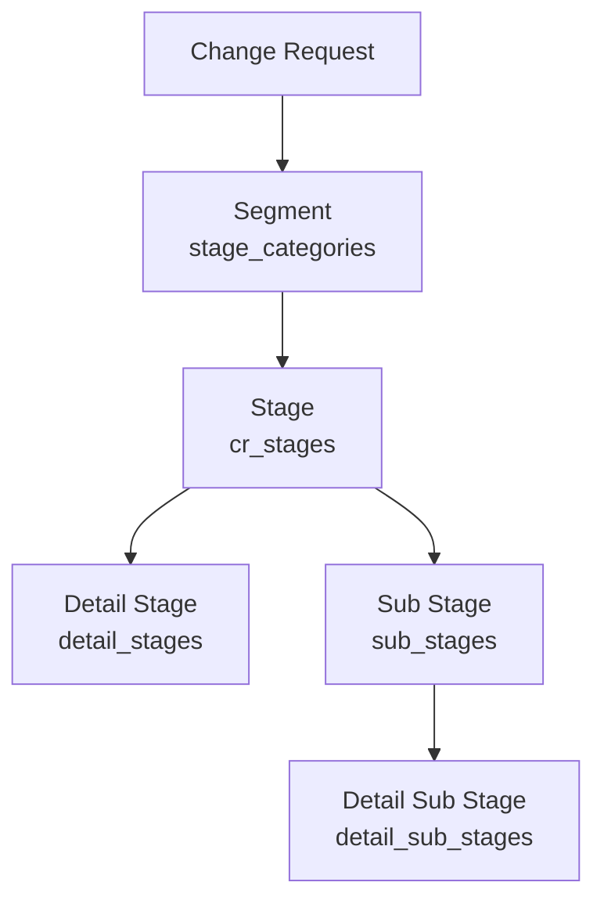
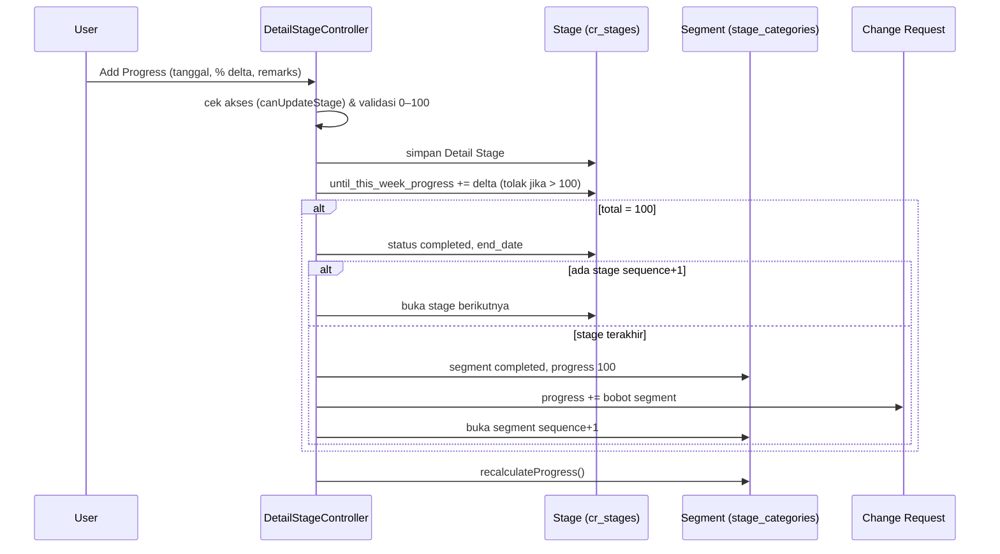

# Hierarki Workflow CR: Segment → Stage → Detail Stage → Sub Stage → Detail Sub Stage

> Dokumen ini menjelaskan lima lapis data yang dipakai untuk melacak progres sebuah Change Request
> (CR), bagaimana setiap lapis dibuat, dan bagaimana progres naik dari lapis paling bawah sampai ke CR.
> Sumber kebenaran skema: `database/migrations/`. Aturan alur yang lebih rinci (FSD, Section 1–3,
> Transport, extend) ada di `.kiro/steering/workflow-stages.md`.

## 1. Gambaran besar

```
ChangeRequest                (change_requests)        progress = jumlah bobot segment yang selesai
 └─ Segment                  (stage_categories)       progress = rata-rata progress stage-nya
     └─ Stage                (cr_stages)              progress = jumlah Detail Stage, atau
         │                                                       rata-rata Sub Stage
         ├─ Detail Stage     (detail_stages)          satu entri progres bertanggal (delta %)
         └─ Sub Stage        (sub_stages)             progress = jumlah Detail Sub Stage
             └─ Detail Sub Stage (detail_sub_stages)  satu entri progres bertanggal (delta %)
```



Sebuah stage memakai **salah satu** dari dua jalur:

- **Jalur biasa:** progres dicatat langsung sebagai Detail Stage.
- **Jalur sub stage:** stage dipecah menjadi Sub Stage, dan progres dicatat sebagai Detail Sub Stage.
  Saat ini jalur ini hanya dipakai stage induk **Development**.

## 2. Template (master) vs data milik CR

Admin mengatur cetakan (template). Saat CR dibuat, cetakan itu **disalin** menjadi data milik CR.

| Template (admin) | Layar admin | Disalin menjadi | Kapan disalin |
|---|---|---|---|
| `categories` | `/categories`, `/cr-settings` | Segment (`stage_categories`) | Saat CR dibuat |
| `master_stages` | `/master-stages` | Stage (`cr_stages`) | Saat CR dibuat |
| `master_sub_stages` | `/master-stages` | Sub Stage (`sub_stages`) | Saat sub stage ditambahkan ke stage Development |

Salinan menyimpan **nama**, bukan foreign key ke template (`cr_stages` tidak punya `master_stage_id`).
Akibatnya:

- Mengubah template **tidak** mengubah CR yang sudah ada. Hanya CR baru yang memakai template baru.
- Kode yang mencocokkan stage dengan template mencocokkan lewat nama, secara longgar (tidak peka
  huruf besar/kecil dan tanda baca).

Penyalinan dilakukan oleh `App\Services\ChangeRequestStageInitializer`, baik dari form tambah CR maupun
dari import spreadsheet:

1. Ambil `categories` sesuai tipe CR (`config` → kategori tipe `config`; selain itu → tipe `cr`),
   urut `sequence`.
2. Untuk setiap kategori, buat Segment dengan `name`, `bobot` dan `sequence` yang sama. Segment
   pertama (`sequence = 1`) berstatus `active`, sisanya `inactive`.
3. Untuk setiap `master_stages` kategori itu, buat Stage. Stage `sequence = 1` di setiap segment
   berstatus `active`, sisanya `inactive`.
4. Stage bertipe `extended` / `extender` **tidak** ikut disalin. Stage itu baru ditambahkan saat CR
   di-extend (`ExtendController`).

## 3. Lapis 1: Segment (`stage_categories`, model `StageCategory`)

Fase besar dalam pengerjaan CR. Seed default untuk CR tipe `cr`:

| sequence | Segment | bobot |
|---|---|---|
| 1 | Preparation | 20 |
| 2 | FSD Creation & Approvals | 20 |
| 3 | Development and SIT | 30 |
| 4 | UAT | 15 |
| 5 | Go-Live | 15 |

CR tipe `config` memakai daftar kategori tipe `config` (misalnya segment **Configuration** menggantikan
fase pengembangan). Bobot di tabel di atas bisa diubah admin.

**Kolom penting:** `cr_id`, `category_id`, `name`, `sequence`, `bobot`, `progress`, `status`
(`active` / `inactive` / `completed`).

**Progress segment** dihitung ulang setiap kali progres stage berubah (`StageCategory::recalculateProgress()`):

```
progress segment = Σ until_this_week_progress semua stage di segment / jumlah stage
```

Segment yang sudah `completed` selalu dibaca 100.

**Kapan segment selesai:** saat stage terakhirnya selesai. Yang terjadi:

1. Segment → `progress = 100`, `status = completed`.
2. `bobot` segment **ditambahkan** ke `change_requests.progress` (`+=`, bukan diganti).
3. Segment dengan `sequence + 1` dibuka (`StageCategory::activate()`): statusnya `active`, dan stage
   pertamanya ikut dibuka dengan `start_date` hari itu.

Jadi progress CR bukan rata-rata. Progress CR adalah **jumlah bobot segment yang sudah selesai**,
sehingga naik bertahap: 0 → 20 → 40 → 70 → 85 → 100.

## 4. Lapis 2: Stage (`cr_stages`, model `CrStage`)

Langkah di dalam segment, misalnya `CR - Section 1`, `CR Signed - Section 2`,
`CR Signed - Section 3`, `FSD Creation`, `Developer Review`, `FSD Approval`, `Development`, `SIT`,
`UAT`, `Transport`. Daftar persisnya mengikuti `master_stages` yang diatur admin.

**Kolom penting:**

| Kolom | Arti |
|---|---|
| `stage_category_id`, `sequence` | Segment induk dan urutannya di dalam segment |
| `name`, `type` | Dipakai untuk menentukan **alur dan tombol** (bukan hak akses) |
| `status` | `inactive` → `active` → `completed` |
| `start_date`, `end_date` | Tanggal stage dibuka dan selesai |
| `this_week_progress` | Progres yang ditambahkan pada entri terakhir |
| `last_week_progress` | Nilai `this_week_progress` sebelumnya |
| `until_this_week_progress` | **Progres kumulatif stage** (0–100). Ini yang dipakai menghitung segment |
| `iteration` | Berapa kali stage diulang (misalnya FSD dikembalikan untuk revisi) |

**Siapa yang boleh meng-update** ditentukan `User::canUpdateStage()` dan tabel
`role_stage_permissions` (Roles → Stage Access), bukan nama stage di kode. Lihat
`.kiro/steering/authorization.md`.

**Kapan stage selesai:** saat `until_this_week_progress` mencapai 100. Yang terjadi:

1. Stage → `status = completed`, `end_date` = tanggal entri.
2. Stage berikutnya (`sequence + 1` di segment yang sama) dibuka lewat `CrStage::start()`: status
   `active`, `start_date` diisi.
3. Kalau tidak ada stage berikutnya, segment ditutup (lihat §3).
4. Progress segment dihitung ulang.

Stage dengan approval (Section 2/3, FSD Creation, FSD Approval, Transport) memakai
`CrStage::advanceBy()` dan `openNextStageOrCloseSegment()`. Hasilnya sama, tetapi progresnya diisi
oleh setiap approval, bukan diketik manual.

## 5. Lapis 3: Detail Stage (`detail_stages`, model `DetailStage`)

Satu **entri progres** pada sebuah stage. Ini riwayat yang tampil di tabel history pada kartu stage.

| Kolom | Arti |
|---|---|
| `cr_stage_id` | Stage induk |
| `date` | Tanggal progres |
| `progress` | **Delta**, bukan total. `+20` artinya stage naik 20%. Bisa negatif (misalnya −20 saat FSD dikembalikan untuk revisi) |
| `remarks` | Catatan |
| `attachment` | File (dokumen FSD, scan Section 1, dokumen UAT, dst.) |
| `submitted_by` | User yang mencatat |

**Alur Add Progress** (contoh: `DetailStageController::preparationProgress`):



Endpoint progres berbeda per jenis stage (`preparationProgress`, `fsdProgress`,
`developerReviewProgress`, `configProgress`), karena aturan tiap stage berbeda. Contohnya, FSD dibatasi
50%/80% sampai diserahkan.

## 6. Lapis 4: Sub Stage (`sub_stages`, model `SubStage`)

Pemecahan sebuah stage menjadi beberapa pekerjaan paralel. Contoh dari template
(`master_sub_stages`, tipe `development`): **ABAP Development**, **BW Development**,
**Digital Application Development**. Di sistem, ini juga mewakili **tim developer**.

| Kolom | Arti |
|---|---|
| `cr_stage_id` | Stage induk (stage Development) |
| `name`, `type` | Disalin dari `master_sub_stages` |
| `progress` | Total progres sub stage (0–100) |
| `status` | `inactive` / `active` / `completed` |

Sub stage tidak punya kolom tanggal. Tanggal mulai dan selesai dibaca dari entri Detail Sub Stage
pertama dan terakhir (`SubStage::startedOn()` / `finishedOn()`).

**Cara sub stage dibuat** (dua jalan, hasilnya sama):

1. **Otomatis saat hand-over developer.** Ketika tim developer dipilih di kartu Developer Review,
   `syncDevelopmentSubStage()` membuat sub stage dengan nama tim tersebut di stage Development.
   Kalau tim diganti, sub stage ikut diganti, selama belum ada progres di sub stage itu.
2. **Manual lewat tombol "Add Sub Stage"** (`SubStageController::storeSubStage`). Tombol hanya muncul
   pada stage induk Development yang **belum** punya sub stage.

Stage induk Development **tidak** menampilkan tombol Add Progress. Progresnya hanya bisa naik
lewat sub stage.

## 7. Lapis 5: Detail Sub Stage (`detail_sub_stages`, model `DetailSubStage`)

Satu entri progres pada sebuah sub stage. Fungsinya sama dengan Detail Stage, satu tingkat lebih bawah.

| Kolom | Arti |
|---|---|
| `sub_stage_id` | Sub stage induk |
| `date` | Tanggal progres |
| `progress` | Delta % |
| `remarks` | Catatan |

**Alur Add Progress sub stage** (`DetailSubStageController::storeProgress`):

1. Cek akses memakai **stage induk** (`canUpdateStage` atas `cr_stages`).
2. Validasi delta 0–100, dan `Σ detail_sub_stages + delta` tidak boleh lebih dari 100.
3. Simpan Detail Sub Stage.
4. `sub_stages.progress = Σ detail_sub_stages.progress`. Kalau sudah 100, sub stage → `completed`.
5. **Naik ke stage induk:**
   ```
   progress stage = Σ progress sub stage / jumlah sub stage
   ```
   Nilai ini disimpan ke `until_this_week_progress`. `this_week_progress` diisi selisihnya dari nilai
   sebelumnya.
6. Kalau progress stage = 100: stage → `completed`, stage `sequence + 1` (biasanya **SIT**) dibuka.
7. Progress segment dihitung ulang.

## 8. Contoh perhitungan lengkap

Segment **Development and SIT** (bobot 30) berisi 2 stage: `Development` (dipecah 2 sub stage) dan
`SIT`.

| Langkah | Detail Sub Stage | Sub Stage | Stage Development | Segment |
|---|---|---|---|---|
| ABAP +60 | ABAP: 60 | ABAP 60, BW 0 | (60+0)/2 = **30** | (30+0)/2 = **15** |
| BW +100 | BW: 100 | ABAP 60, BW 100 ✔ | (60+100)/2 = **80** | (80+0)/2 = **40** |
| ABAP +40 | ABAP: 60+40 | ABAP 100 ✔, BW 100 ✔ | **100** ✔ → SIT dibuka | (100+0)/2 = **50** |
| SIT +100 (Detail Stage) | – | – | SIT **100** ✔ | segment selesai → **100** |

Setelah langkah terakhir, CR mendapat `+30` (bobot segment) dan segment **UAT** dibuka.

## 9. Ringkasan aturan

| Lapis | Tabel | Diisi oleh | Progress dihitung dari | Selesai saat | Efek ke atas |
|---|---|---|---|---|---|
| Change Request | `change_requests` | Form / import CR | Σ bobot segment selesai | Segment terakhir selesai | – |
| Segment | `stage_categories` | Salinan `categories` | Rata-rata `until_this_week_progress` stage | Stage terakhir selesai | CR `+= bobot`, buka segment berikutnya |
| Stage | `cr_stages` | Salinan `master_stages` | Σ Detail Stage **atau** rata-rata Sub Stage | Progress = 100 | Buka stage berikutnya / tutup segment |
| Detail Stage | `detail_stages` | User (Add Progress) / approval | – (delta) | – | Menambah progress stage |
| Sub Stage | `sub_stages` | Hand-over developer / Add Sub Stage | Σ Detail Sub Stage | Progress = 100 | Menyumbang rata-rata ke stage |
| Detail Sub Stage | `detail_sub_stages` | User (Add Progress sub stage) | – (delta) | – | Menambah progress sub stage |

## 10. Catatan dan hal yang perlu diwaspadai

- **Penelusuran selalu memakai `sequence` dalam induk yang sama.** "Stage berikutnya" berarti
  `sequence + 1` di `stage_category_id` yang sama. "Segment berikutnya" berarti `sequence + 1` di
  `cr_id` yang sama. Urutan `sequence` yang bolong atau ganda di template akan merusak alur.
- **Progress CR tidak naik selama segment belum selesai.** Segment yang sudah 90% tetap
  menyumbang 0 ke CR.
- **Jalur sub stage tidak menutup segment.** `DetailSubStageController` hanya membuka stage
  `sequence + 1`. Kalau stage ber-sub stage adalah stage **terakhir** di segmentnya, segment tidak
  ditutup dan bobotnya tidak ditambahkan. Ini aman selama Development selalu diikuti SIT, tetapi
  perlu diingat kalau template diubah.
- **Delta negatif** (send-back FSD, feedback Section 3) mengurangi progress stage. Stage yang sudah
  `completed` bisa dibuka lagi (`active`). Bobot yang sudah masuk ke CR tidak dikurangi kembali.
- **CR lama** (`date_receive` sebelum 2026-10-01) menyelesaikan Section 1–3, FSD dan Transport
  dengan upload dokumen saja (`CrStage::takesDocumentUploadOnly()`).
